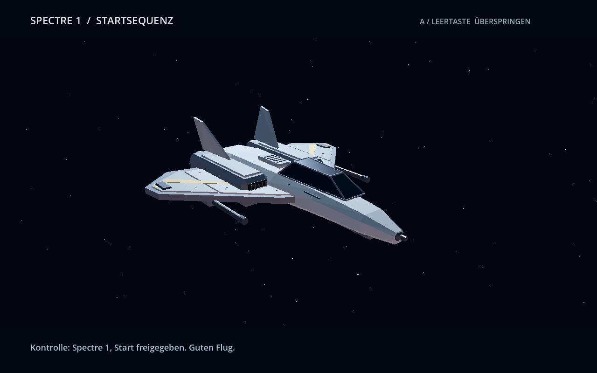
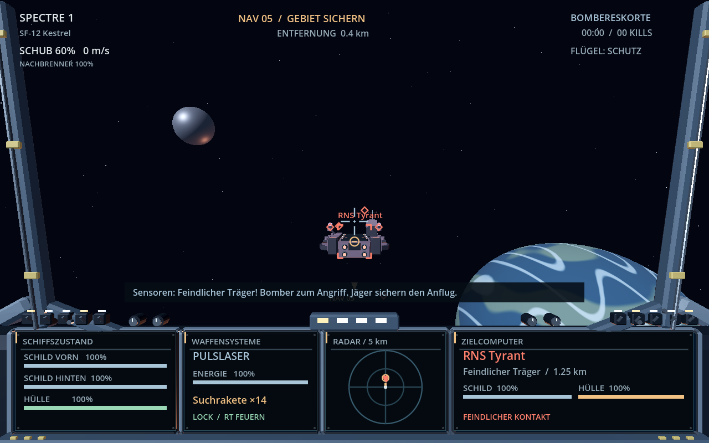
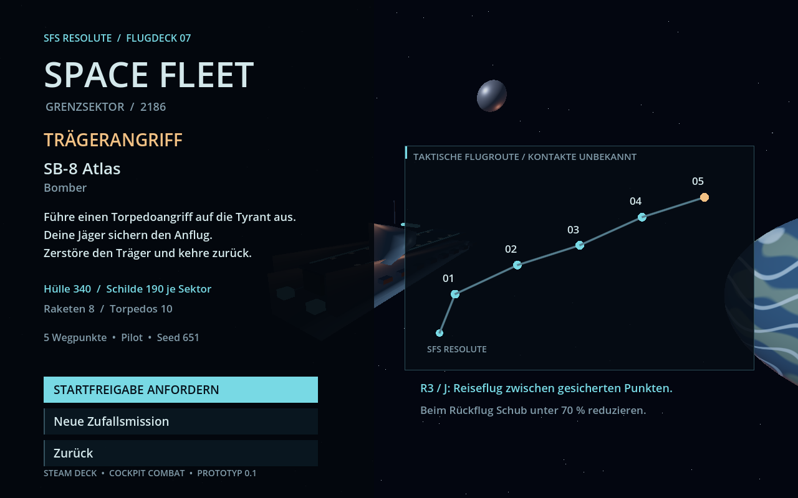

# SPACE FLEET — Prototyp 0.2 / Flotte A

> **KI-generiertes Spiel / AI-generated game**
>
> Space Fleet wurde mit ChatGPT / OpenAI Codex nach menschlichen Vorgaben erstellt. Quellcode, prozedurale 3D-Modelle und Projektdokumentation wurden mithilfe generativer KI erzeugt und überarbeitet. Spielidee, Anforderungen und Rückmeldungen stammen vom Projektinhaber.
>
> Space Fleet was created with ChatGPT / OpenAI Codex from human-provided requirements. Its source code, procedural 3D models and project documentation were generated and revised using generative AI. The project owner provides the game concept, requirements and feedback.

Ein Einzelspieler-Weltraumkampfspiel in Godot 4.5 mit C#, ausgelegt auf Steam Deck / SteamOS (Linux x86_64) und normale Gamepads. Eigene Schiffe und Spielwelt, inspiriert von klassischen Träger-basierten Raumkampfsimulationen.

Der Quellcode steht unter der [MIT-Lizenz](LICENSE).

## Neu in Version 0.2

Der gewählte Stil **A – Flotte** ist als erster Grafikschritt eingebaut:

- SF-12 Kestrel mit eigenem GLB-Modell: facettierter Rumpf, gepfeilte Flügel, Doppeltriebwerke, Kanzelrahmen und dezente gelbe Flottenmarkierungen.
- Neues gemeinsames Flotten-Cockpit für alle drei spielbaren Klassen: schmalere Streben, modellierte Displayfassungen, Schalter und Drehregler.
- Ruhigere blau-weiße Instrumente; Schub und Flügelstatus sind oberhalb der mechanischen Konsolen angeordnet.
- Das Cockpit bleibt auch beim Nachbrenner-FOV-Effekt auf die Instrumente ausgerichtet.

Zum Testen des neuen Außenmodells **Bombereskorte / Kestrel** auswählen. In den anderen Missionen fliegen bereits verbündete Kestrel-Jäger mit. Die restlichen Außenmodelle werden erst nach deinem Steam-Deck-Test überarbeitet. Flugverhalten, Waffenwerte und Missionsregeln bleiben erhalten.







## Sofort spielen auf dem Steam Deck

Die kompilierte Linux-Version wird unter [Releases](../../releases) bereitgestellt. Im Spielarchiv liegt unter `SpaceFleet/` die Programmdatei. Für diese Version brauchst du weder Godot noch ein installiertes .NET SDK.

1. Archiv im Desktop-Modus **vollständig entpacken**.
2. `SpaceFleet/SpaceFleet.x86_64` über die Dateieigenschaften als ausführbar markieren, falls der Entpacker das Ausführungsrecht nicht erhält.
3. In Steam **Spiel hinzufügen → Steam-fremdes Spiel hinzufügen** wählen und `SpaceFleet.x86_64` auswählen.
4. Controllerlayout **Gamepad** verwenden. Das Spiel läuft nativ unter Linux; keine Proton-Kompatibilität erzwingen.
5. In den Gaming-Modus wechseln und starten. Alle Dateien und den Ordner `data_SpaceFleet_linuxbsd_x86_64` beim Programm belassen.

Alternativ im Desktop-Terminal im entpackten Ordner `SpaceFleet`:

```bash
chmod +x SpaceFleet.x86_64
./SpaceFleet.x86_64
```

## Erste Mission

Beginne mit **Patrouille** auf Schwierigkeit **Kadett**. Im Briefing bekommst du die Vanguard zugeteilt. A startet den Einsatz, A überspringt nach einem kurzen Moment die Startsequenz.

Folge der goldenen NAV-Markierung. Mit R3 schaltest du in freien Gebieten den fünffachen Reiseflug ein. Er endet vor dem Wegpunkt oder bei Feindkontakt automatisch. Räume den aktivierten Wegpunkt von Gegnern frei; der nächste Wegpunkt wird anschließend automatisch freigeschaltet.

X schaltet durch Feinde und Träger-Subsysteme. Halte ein Ziel vor dir, bis die Rakete aufgeschaltet hat. LT feuert Energiewaffen, RT feuert eine Rakete. Nach Abschluss aller Wegpunkte fliegst du zur Resolute zurück. Für die automatische Landung die Geschwindigkeit auf unter 80 % der normalen Höchstgeschwindigkeit reduzieren (empfohlen: Schub unter 70 %). Der Reiseflug muss beendet sein.

## Missionen

| Auftrag | Dein Schiff | Siegbedingung |
| --- | --- | --- |
| Patrouille | SF-24 Vanguard, mittlerer Jäger | Alle Wegpunkte sichern und zurückkehren |
| Bombereskorte | SF-12 Kestrel, leichter Jäger | Feindträger zerstören, mindestens einen der zwei Bomber schützen, zurückkehren |
| Trägerangriff | SB-8 Atlas, Bomber | Feindträger mit eigener Bewaffnung und Begleitschutz zerstören, zurückkehren |

Jede Mission hat 3–5 zufällig platzierte Navigationspunkte und einen reproduzierbaren Seed. Der erste Punkt ist sicher. Zwischenpunkte enthalten freien Raum oder Feindgeschwader. Eskorte und Trägerangriff enden mit einem garantierten Feindträger, die Patrouille mit einem garantierten Feindgeschwader. Eine Patrouille ist in dieser Version kein Trägerkampf. Die Auswertung kann denselben Seed erneut starten.

Drei Schwierigkeitsgrade beeinflussen Feindanzahl, Feindhülle, Feuerfrequenz und Torpedoabwehr. Verfügbare Schiffe und Bewaffnung hängen vom Auftrag ab, nicht vom Zufall.

## Controller und Tastatur

| Funktion | Gamepad / Steam Deck | Tastatur |
| --- | --- | --- |
| Drehen / Neigen | Linker Stick | A D / W S |
| Schub erhöhen / verringern | Rechter Stick hoch / runter | R / F |
| Rollen | Rechter Stick links / rechts | Q / E |
| Energiewaffe | LT halten | Leertaste |
| Rakete / Torpedo | RT drücken | Enter |
| Energiewaffe wechseln | LB | Tab |
| Raketentyp wechseln | RB | C |
| Kontakt im Visier auswählen | A | T |
| Nächster Feind / Subsystem | X | G |
| Aktuellen Navigationspunkt bestätigen | Y | N |
| Nachbrenner | B halten | Umschalt halten |
| Reiseflug ×5 an / aus | Rechten Stick drücken (R3) | J |
| Formation | D-Pad oben | 1 |
| Mein Ziel angreifen | D-Pad rechts | 2 |
| Bomber schützen | D-Pad unten | 3 |
| Flügel zurückrufen | D-Pad links | 4 |
| Pause | Menü / Start | Escape |
| Zwischensequenz überspringen | A | Leertaste |

**Der Schub bleibt beim Loslassen des rechten Sticks erhalten.** Stick rechts/links rollt das Schiff. Der Nachbrenner hat einen wiederaufladbaren Vorrat. Die Energiewaffen haben unbegrenzt Munition, benötigen aber regenerierende Waffenenergie. Raketen und Torpedos werden verbraucht; beim nächsten Einsatz wird neu ausgerüstet.

Menüs: D-Pad / linker Stick zur Auswahl, A zum Bestätigen. Stickempfindlichkeit, invertierte Höhensteuerung, Ton und Schwierigkeit sind unter Optionen einstellbar. Freie Tastenbelegung und Maussteuerung sind in dieser Version noch nicht enthalten.

## Cockpit

- Eigene vordere und hintere Schilde sowie Hülle.
- Waffenenergie, aktive Energiewaffe, aktiver Raketentyp und dessen Restbestand.
- Zielname, Schiffsklasse, Entfernung, Schild- und Hüllenzustand.
- Zielrahmen, Vorhaltemarke und Richtungspfeile für Kontakte außerhalb des Blickfeldes.
- 5-km-Radar: grün = verbündet, rot = feindlich, gold = Navigation / ausgewählter Kontakt.
- Radarstriche zeigen die relative Höhe zum eigenen Schiff.
- Zielerfassung, Raketenwarnung, kritische Hülle und textbasierter Funk.

## Gefechte

Schilde regenerieren nach vier Sekunden ohne Treffer. Hüllenschäden bleiben bis zum nächsten Einsatz bestehen. Bei kritischer Hülle reagieren die Steuerdüsen langsamer. Ionenkanonen sind gegen Schilde besonders wirksam; Plasma verursacht hohe Einzelschäden.

Raketen benötigen ein feindliches Ziel im vorderen Erfassungskegel. Torpedos haben drei Sekunden Aufschaltzeit, große Reichweite und hohen Schaden gegen Träger. Feindliche Jäger verfügen ebenfalls über begrenzte Raketen. Der Träger hat automatische Geschützabwehr und eine vereinfachte, zufallsbasierte Torpedoabwehr.

Die beiden Schildgeneratoren des Feindträgers können separat anvisiert werden. Ihre Zerstörung entzieht Schildenergie; nach Verlust beider Generatoren regeneriert der Träger seine Schilde nicht mehr. Energiewaffen können einen Träger ebenfalls zerstören, benötigen dafür jedoch erheblich länger.

Die Flügel-KI folgt, kämpft, schützt Bomber und greift ausgewählte Gegner an. Bomber verfolgen am Hauptziel ihren Torpedoauftrag. Zum Missionsende schließt der Flügel wieder zum Spieler auf.

## Projekt öffnen und ändern

Voraussetzungen für den **Quellcode**, nicht für die kompilierte Version:

- Godot **4.5 .NET / C#**, einschließlich passender .NET-Exportvorlagen.
- .NET **8 SDK** oder eine kompatible neuere SDK-Version mit .NET-8-Zielunterstützung.
- Für den ersten Restore eine Internetverbindung zum NuGet-Paketfeed.

`project.godot` importieren, C# bauen und F6/F5 bzw. „Projekt starten“ verwenden. Das Projekt verwendet den Compatibility-Renderer. Ausgangsauflösung: 1280 × 800.

```bash
cd SpaceFleet
dotnet build SpaceFleet.csproj
godot --path .

# Exportvorlagen müssen vorher installiert sein:
mkdir -p build
godot --headless --path . --export-release "Steam Deck"
```

Je nach Installation heißt das Godot-Programm `godot`, `godot4` oder entsprechend der heruntergeladenen .NET-Version. `build.sh` akzeptiert deshalb `GODOT_BIN=/pfad/zur/godot-binary`.

### Aufbau

| Datei | Aufgabe |
| --- | --- |
| `Scripts/Game.cs` | Zustände, Trägersequenzen, Missionsablauf, Begegnungen, Profil und Integrationstests |
| `Scripts/Definitions.cs` | Datenmodelle, Seed-basierte Routengenerierung, JSON-Loader |
| `Scripts/ShipUnit.cs` | Flugmodell, Schilde, Waffen, Zielerfassung und Flügel-/Feind-KI |
| `Scripts/Projectile.cs` | Lenkwaffen und kontinuierliche Trefferprüfung |
| `Scripts/Controls.cs` | Gamepad- und Tastaturbelegung, Stick-Totzone |
| `Scripts/Hud.cs` | Controller-Menüs, Briefing, Radar, Zielcomputer, Auswertung |
| `Scripts/Visuals.cs` | Prozedurale 3D-Modelle, Cockpit, Planeten und Sterne |
| `Scripts/SoundSynth.cs` | Synthetisierte Waffen-, Triebwerks- und Warnsignale |
| `Data/ships.json` | Schiffsattribute und Ausrüstung |
| `Data/weapons.json` | Waffenattribute und Raketeneigenschaften |

Balancing lässt sich direkt in den JSON-Dateien ändern. Neue Schiffs-IDs benötigen außerdem eine Auswahl in Missionsgenerator bzw. Spawner; das prozedurale Erscheinungsbild kann in `Visuals` angepasst oder durch eigene GLB-Modelle ersetzt werden. Neue Begegnungstypen werden in `Encounter`, `MissionPlan.Generate` und `Game.Activate` ergänzt.

Spielprofil: Godots `user://pilot.cfg`, unter SteamOS gewöhnlich `~/.local/share/godot/app_userdata/Space Fleet/pilot.cfg`. Gespeichert werden Optionen und Bestleistungen; laufende Missionen werden nicht zwischengespeichert.

## Prüfungen

```bash
dotnet build
godot --headless --path . --quit-after 600 -- --self-test
```

Die integrierten Prüfungen kontrollieren unter anderem 300 generierte Missionen, reproduzierbare Routen, garantierte Ziele, Schiffszuteilung, Trefferberechnung, Schilde, Torpedoverbrauch und -treffer, alle drei Missionsabläufe bis zur Landesequenz sowie die Niederlage bei Verlust beider Bomber. Ein Fehler beendet den Testlauf mit Exit-Code 1.

`VALIDATION.md` dokumentiert die tatsächlich ausgeführten Prüfungen dieser Ausgabe.

## Stand und Grenzen

Spielbarer Prototyp mit eigenem C#-Quellcode und nativem Linux-Build. Kestrel und Cockpit verwenden eigene GLB-Modelle im Flottenstil. Bomber, mittlerer Jäger, Gegner und Träger verwenden weiterhin die bisherigen prozeduralen Außenmodelle. Der gewählte Entwurf dient als Stilrichtung; diese erste Umsetzung erreicht noch nicht alle Details der Konzeptgrafik. Textfunk und synthetisierte Effekte sind vorhanden, Sprachausgabe und Musik noch nicht. Trefferkörper sind vereinfachte Kugeln; Torpedoabwehr und Schadensmodell sind bewusst kompakt. Kein Multiplayer, keine Kampagne und kein kommerziell fertiges Balancing.

Das Projekt zielt auf Steam Deck. Die Bildrate, reale Controllerbedienung und das Verhalten im Steam-Gaming-Modus müssen auf einem echten Steam Deck geprüft werden; eine Hardwareprüfung ist nicht Teil dieser Ausgabe.

## Referenzen

- https://docs.godotengine.org/en/4.5/tutorials/scripting/c_sharp/c_sharp_basics.html
- https://docs.godotengine.org/en/4.5/tutorials/export/exporting_for_linux.html

## Lizenz

Der eigene Quellcode und die prozeduralen Inhalte stehen unter der [MIT-Lizenz](LICENSE), Copyright (c) 2026 dark-man1978. Die Hinweise für Godot, .NET und deren Drittkomponenten bleiben unter [Licenses](Licenses) erhalten; für diese Komponenten gelten ihre jeweiligen Lizenzbedingungen.

## Automatische GitHub-Releases

Der Workflow unter `.github/workflows/release.yml` baut nach dem ersten Push auf `main` die Version `v0.2.0`, führt die integrierten Tests aus und veröffentlicht das native Steam-Deck-Spiel als ZIP-Anhang eines GitHub-Releases. Vorhandene Releases werden nicht überschrieben. Weitere Versionen können über „Actions → Build and publish Steam Deck release → Run workflow“ mit einem neuen Tag erstellt werden.

Der Workflow ist vorbereitet; der erste GitHub-Actions-Lauf steht bis zur Repository-Erstellung und dem Upload aus.

### Grafikmodelle neu erzeugen

Die fertigen GLB-Dateien sind eingecheckt; für normales Bauen und Spielen sind keine zusätzlichen Python-Pakete erforderlich. Die reproduzierbare Geometriequelle liegt unter `Tools/build_fleet_assets.py`:

```bash
python3 -m pip install numpy scipy
python3 Tools/build_fleet_assets.py
```

Alle Geometrien sind selbst erstellt und stehen unter MIT. Der Jäger umfasst 4.722 Dreiecke in 12 Materialflächen; das Cockpit 4.308 Dreiecke in 9 Materialflächen. Keine externen Modelle oder Bildtexturen werden nachgeladen. Die tatsächliche Bildrate wird auf dem Steam Deck geprüft.
